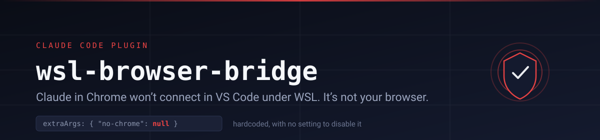
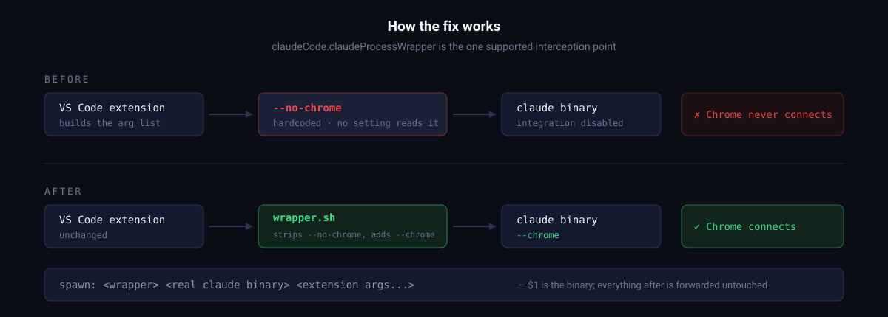
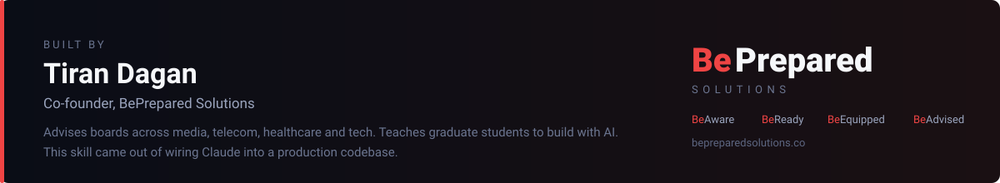

<p align="center">
  <em>A Claude Code skill by <a href="https://bepreparedsolutions.co">Tiran Dagan</a> —
  because the fix took a day to find and should take you two minutes.</em>
</p>

# claude-chrome-wsl-fix

Browser control for **Claude Code on Windows + WSL**, two ways:

| | Route 1: Claude in Chrome | Route 2: your Windows Chrome |
|---|---|---|
| What Claude drives | A Chrome installed **inside WSL** (it shows on your Windows desktop through WSLg) | The Chrome installed on **Windows**, in a separate automation profile |
| How | The official Claude in Chrome extension and its tools | The Chrome DevTools Protocol, through a small `cdp` command |
| The problem it solves | The VS Code extension launches Claude with `--no-chrome`, and no setting turns it off | The extension can never see a Windows browser from WSL |
| One-time cost | One VS Code window reload, sign in to the extension | Possibly one WSL restart (mirrored networking) |

Install either or both.

## Install: one line to Claude

Open Claude Code inside WSL and send:

```
Follow https://github.com/tirandagan/claude-chrome-wsl-fix/blob/main/SETUP.md to set up browser control on my computer.
```

Claude checks your environment first (read-only), asks which route you want,
shows you every change before making it, installs, has you do the one reload or
restart that ends the chat, and verifies in the next one. **[SETUP.md](SETUP.md)**
is that script, readable by you too. It ends with a manual install if you'd
rather type the commands yourself.

Already cloned? From the repo:

```bash
scripts/preflight.sh            # read-only check of both routes
scripts/install.sh              # Route 1   (--dry-run to preview, --uninstall to undo)
scripts/install-windows-chrome.sh   # Route 2   (--dry-run, --set-mirrored, --uninstall)
scripts/install-skills.sh       # make the skills visible to Claude Code
```

## Route 1: why reinstalling the extension never fixes it

The failure is not in the browser. The VS Code extension hardcodes
`--no-chrome` into the arguments it passes to the Claude CLI:

```js
extraArgs:{debug:null,"debug-to-stderr":null,"enable-auth-status":null,
           "no-chrome":null,"replay-user-messages":null}
```

No `claudeCode.*` setting reads it, so there is nothing to switch off. It has
persisted across extension updates. Because it is a *launch* flag, a session
that started with it cannot enable the integration afterwards. That's why
restarting the browser, reinstalling the extension and signing in again all
appear to change nothing.

VS Code exposes one supported interception point,
`claudeCode.claudeProcessWrapper`. When set, the extension launches your script
instead of the binary and hands the real binary over as the first argument:

```
<your wrapper> <real claude binary> <all the extension's args...>
```



The wrapper drops `--no-chrome`, appends `--chrome`, and forwards everything
else byte for byte. About ten lines of shell.

**The catch:** the flag is necessary but not sufficient. The Claude CLI is a
Linux process inside WSL, and it looks for the extension in *Linux* browser
profiles. A Chrome installed on Windows is invisible to it. So Route 1's browser
is a Chrome **installed inside WSL**, with the extension installed and signed in
there. If you launch Claude from a plain WSL terminal, you don't need the
wrapper at all: `claude --chrome`.

## Route 2: driving the Windows Chrome

When you want Claude in the browser you actually use on Windows, the extension
can't help. Its Windows native host launches a *Windows* `claude.exe`, which a
WSL session never sees. Route 2 uses the DevTools Protocol instead:

- `launch-windows-chrome.sh` starts Windows Chrome on a **dedicated profile**
  with a debug port (9333). Chrome 136+ refuses debug ports on your default
  profile by design, so your everyday profile is never touched.
- WSL reaches that port through **mirrored networking** (`networkingMode=Mirrored`
  in `%UserProfile%\.wslconfig`).
- `cdp` is a dependency-free client (Node 22+): `new`, `goto`, `text`, `click`,
  `type`, `key`, `wait`, `eval`, `shot`, `close`. Clicks go only to **visible**
  elements and count as real user input.

```bash
launch-windows-chrome.sh
T=$(cdp new https://example.com); cdp text --tab $T; cdp shot page.png --tab $T; cdp close $T
```

The `windows-chrome` skill teaches Claude this routine, including the rules: its
own tab only, never type credentials, leave port 9222 to whatever uses it.
Details: [references/windows-chrome-cdp.md](references/windows-chrome-cdp.md).

## What gets changed

| Route | Path | Purpose |
|---|---|---|
| 1 | `~/.claude/bin/claude-chrome-wrapper.sh` | the launch shim |
| 1 | `~/.vscode-server/data/Machine/settings.json` | one key, `claudeCode.claudeProcessWrapper` (backup `.bak`) |
| 2 | `~/.claude/bin/launch-windows-chrome.sh`, `cdp`, `cdp.mjs` | launcher and client |
| 2 | `~/.config/claude-chrome-wsl-fix/windows-chrome.env` | port, profile, chrome.exe path |
| 2 | `%UserProfile%\.wslconfig` | only with `--set-mirrored`, backed up first |
| both | `~/.claude/skills/claude-chrome-wsl-fix`, `~/.claude/skills/windows-chrome` | skill links into this repo |
| both | `~/.config/claude-chrome-wsl-fix/state.env` | progress, so Claude can resume after a reload |

Route 1's setting goes in **Remote [WSL] Machine settings**, deliberately not User
settings. Those sync across machines, and a Linux path landing on your Mac would
break Claude Code there. The installer refuses to rewrite a settings file with
`//` comments and gives you the one line to paste instead.

## Risk, stated plainly

- **Route 1:** once registered, **every** VS Code Claude session launches through
  the wrapper, including agents already running. If the script is deleted or the
  extension changes its argument shape, sessions fail to start. `install.sh`
  self-tests the wrapper against a stub binary before registering it, and
  uninstall is one command. `CLAUDE_CHROME_WRAPPER=off` makes it pass arguments
  through untouched.
- **Route 2:** anything signed in to the automation profile can be driven by
  **any** local process while Chrome is running with the port open. Sign in there
  only to accounts you're willing to hand to automation, and
  `launch-windows-chrome.sh --stop` when you're done.

## Uninstall

```bash
scripts/install.sh --uninstall                 # Route 1, then reload the window
scripts/install-windows-chrome.sh --uninstall  # Route 2
scripts/install-skills.sh --uninstall          # skill links
```

`.wslconfig` and the Windows automation profile are left alone on purpose.

## Layout

```
claude-chrome-wsl-fix/
├── SETUP.md                       guided install, written for Claude to follow
├── SKILL.md                       skill: claude-chrome-wsl-fix (setup, diagnosis, repair)
├── skills/windows-chrome/SKILL.md skill: windows-chrome (day-to-day Route 2 use)
├── scripts/
│   ├── preflight.sh               read-only check of both routes
│   ├── diagnose.sh                Route 1 in depth, 8 checks
│   ├── install.sh                 Route 1 install / --dry-run / --uninstall
│   ├── claude-chrome-wrapper.sh   the Route 1 shim
│   ├── install-windows-chrome.sh  Route 2 install / --dry-run / --set-mirrored / --uninstall
│   ├── windows-chrome/            launch-windows-chrome.sh, cdp, cdp.mjs (installed to ~/.claude/bin)
│   ├── install-skills.sh          link the skills into ~/.claude/skills
│   └── lib.sh                     shared helpers
├── references/
│   ├── root-cause.md              forensics + how to re-verify after updates
│   ├── windows-chrome-cdp.md      Route 2 internals and security
│   └── troubleshooting.md         symptom → fix, both routes
├── tests/run.sh                   offline test suite (CI runs it)
└── CHANGELOG.md
```

## Verified against

Claude Code VS Code extension **2.1.278**, **2.1.280** and **2.1.314**; Chrome 155
on Windows and 156 in WSL; WSL2 (Debian) on Windows with mirrored networking.
`references/root-cause.md` has the commands to re-confirm on a newer build.
Worth running if the fix ever stops working.

---



## Who made this, and why it exists

This skill is a by-product. It exists because I hit the bug myself, spent a day
inside a minified extension bundle working out that the browser was never the
problem, and decided nobody else should have to.

I'm **[Tiran Dagan](https://bepreparedsolutions.co)**, co-founder of
**[BePrepared Solutions](https://bepreparedsolutions.co)**. I've advised
executives and boards at global firms across media, telecom, healthcare and
tech, and I teach graduate students how to build with AI. These days I spend
most of my time building — which is how a WSL argument-forwarding bug ended up
costing me an afternoon.

### What BePrepared is

> The world's most comprehensive preparedness ecosystem. Monitoring, planning,
> supplies, and expert consulting, all built around your household's specific
> situation.

Most preparedness advice is a 400-page PDF and a shopping list that assumes your
life looks like someone else's. We built the opposite: a system that starts from
*your* address, *your* household, *your* actual risks, and tells you what to do
next.

Four products, one plan:

| | |
|---|---|
| **BeAware** | Live monitoring for your address — FEMA IPAWS alerts, utility outages, local emergencies. *So you never find out last.* |
| **BeReady** | An AI-generated preparedness plan: risk assessment, evacuation routes, day-by-day timeline, the skills you'd actually need. |
| **BeEquipped** | Curated kits matched to your plan, not to a generic checklist. |
| **BeAdvised** | Time with real experts — founders and consultants who've done this for a living. |

### Why a developer might find it interesting

If you build things, the engineering is the part worth a look. BeAware ingests
the **FEMA IPAWS** alert feeds, resolves **which utility actually serves a given
street address** against thousands of service-territory polygons in PostGIS, and
discovers the JSON endpoints behind utility outage maps so it can normalise wildly
inconsistent data into one schema. The planning side runs an AI pipeline that
scales supply quantities by household composition and time horizon, and generates
evacuation routing that changes depending on whether you'd be on foot or in a car.

It's a genuinely hard data problem wearing a calm consumer interface.

**→ [bepreparedsolutions.co](https://bepreparedsolutions.co)**

### If this skill saved you an afternoon

Take a look at what else I'm building — or just send this skill to the next
person who says "Claude in Chrome isn't working and I've reinstalled it twice."

---

<sub>Licensed for free use and redistribution. Not affiliated with or endorsed by
Anthropic. "Claude" and "Claude Code" are trademarks of Anthropic.</sub>
